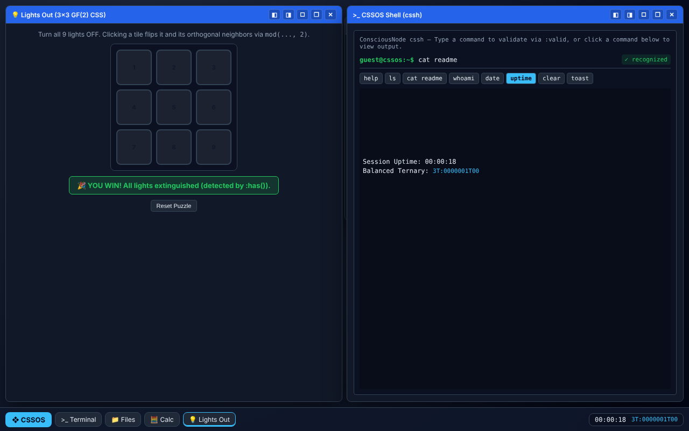

# CSSOS

**A graphical operating system made entirely of CSS. Zero JavaScript.**

▶ **Try it:** https://consciousnode.github.io/CSSOS/ (current Chrome/Edge)

The stylesheet *is* the OS. Windows open, close, focus and snap through hidden checkboxes and radios plus `:has()`. Files live in `
` folders and open through `:target`. The terminal recognizes commands with an input `pattern` and `:valid`. The taskbar clock counts uptime with an animated `@property`, in decimal and **balanced ternary**. Paint is a grid of checkboxes, the calculator is `calc()` plus counters, and Lights Out works out its parity with `mod()`. The file has no `<script>` tag and no event handler anywhere.

Nothing survives a reload except the URL `#hash`. That's honest: there's no storage without JS.

## Credits
- Idea: Kham, ConsciousNode SoftWorks. Spec: Kehai Interim ([SPEC.md](SPEC.md)).
- Built by Gemini 4 Hydrogen, whose build report is in [REPORT.md](REPORT.md).
- Inspired by Lyra Rebane's [x86CSS](https://lyra.horse/x86css/) and Ahmed Amer's CSS-DOS, which proved CSS can compute. CSSOS has no emulated CPU: the cascade is the kernel.

MIT License.
